<div align="center">

# 🦀 Clawd Sticker Studio

**12 handcrafted animated pixel stickers • 12 款像素动态表情**

*Tiny orange crab. Big feelings.*

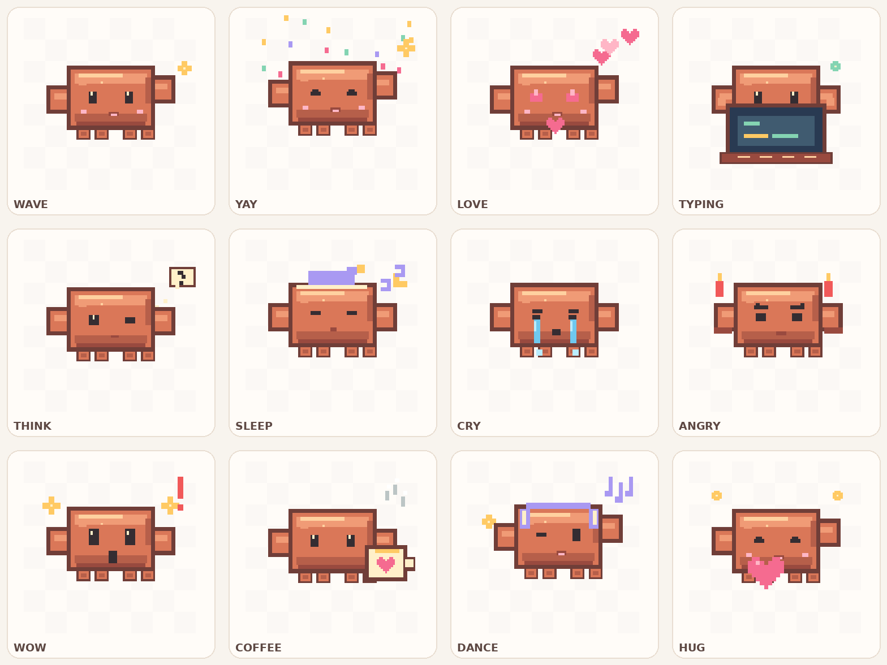

[**🌈 Gallery**](index.html) · [**GIFs**](gifs/) · [**PNGs**](png/) · [**Source**](render.py)

</div>

---

### ✦ The collection / 表情包合集

| Sticker | Mood | 中文 | Sticker | Mood | 中文 |
|:--:|---|---|:--:|---|---|
| 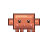 | `wave` | 挥手 | 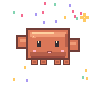 | `yay` | 庆祝 |
| 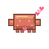 | `love` | 爱心 | 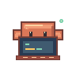 | `typing` | 敲代码 |
| 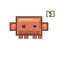 | `think` | 思考 | 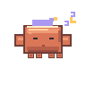 | `sleep` | 睡觉 |
| 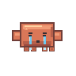 | `cry` | 哭哭 | 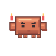 | `angry` | 生气 |
| 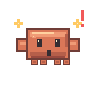 | `wow` | 震惊 | 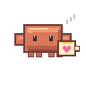 | `coffee` | 咖啡 |
| 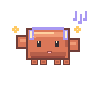 | `dance` | 跳舞 | 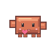 | `hug` | 抱抱 |

> The GIFs above are 96 × 96 pixels internally, drawn on a fixed pixel grid, then displayed with crisp nearest-neighbor scaling. The transparent background works in sticker-capable apps.

### ✦ What's inside / 内容

- `gifs/` — 12 **transparent, infinitely looping GIFs**, 16 frames each / 12 个透明循环动图。
- `png/` — 12 transparent **384 × 384 PNG** still stickers / 12 张高清静态版。
- `preview/contact-sheet.png` — overview / 总览图。
- `index.html` — self-contained, responsive sticker gallery with direct download links / 在线预览与下载页。
- `render.py` — reproducible Pillow-based animation source / 可重复生成动画的源代码。
- `requirements.txt` — Python dependency / Python 依赖。

### ✦ Generate / 重新制作

```bash
python -m pip install -r requirements.txt
python render.py
```

No source image, font download, API keys, or remote assets are required. / 不依赖第三方图片、字体或 API。

### ✦ Design notes / 设计原则

One consistent silhouette, 12 different emotions. Pixel edges are intentionally crisp; no resampling blur. Every file is real GIF/PNG with alpha transparency, not an MP4 disguised as an animation. Colors and geometry come from one reusable drawing rig, so frames do not drift.

### ✦ Fan-art notice / 非官方声明

Unofficial, independently drawn fan-made sticker collection inspired by the Clawd mascot associated with Claude Code. **Not affiliated with, sponsored, or endorsed by Anthropic.** The names Claude, Claude Code and Clawd are trademarks or identifiers of their respective owners. All icon shapes, animations and code in this project were independently created for this fan project. The generator source code is available under the MIT License; the mascot identity and any third-party rights are not included in that license. Use generated images personally and respect the rights of the original mascot owner.

---

<div align="center"><sub>Made with tiny pixels & a lot of care ✿</sub></div>